<!-- Profile README for Rizky Akbar Mokolanot (@Mondayszz) | Theme: futuristic Gundam RX-78-2 -->
<!-- Animated panels live in the /assets folder of this repo (header, pilot-data, pilot-class, progress, divider) -->

  

<!-- ===== TYPING ANIMATION ===== -->

  

 

<!-- ===== PILOT BADGES ===== -->

  
  
  

## 🤖 Mobile Suit Hangar

  <table>
    <tr>
      <td align="center">
        
      </td>
      <td align="center">
        
      </td>
    </tr>
  </table>

## 🧑‍🚀 Pilot Data

  

 

  

 

- 🔭 Exploring **machine learning & deep learning** on real-world data
- 🛡️ Training in **cybersecurity**: pentesting, CTFs, network security analysis
- 🧪 Fusion tech: **AI for threat detection** and **ML model security**

## ⚙️ Weapon Systems (Tech Stack)

### 🧠 Neural Core: Machine Learning & Data Science

  

  
  
  
  
  
  

### 🛡️ Armor Systems: Cybersecurity

  
  
  
  
  
  

### 🔧 Hangar Tools: Data, Backend & DevOps

  

## 📡 Pilot Telemetry (GitHub Stats)

  
  

  

## 🐍 Contribution Radar

  <picture>
    <source media="(prefers-color-scheme: dark)" srcset="https://raw.githubusercontent.com/Mondayszz/Mondayszz/output/github-snake-dark.svg" />
    <source media="(prefers-color-scheme: light)" srcset="https://raw.githubusercontent.com/Mondayszz/Mondayszz/output/github-snake.svg" />
    
  </picture>

## 🎯 Upgrade Progress

  

 

| Module | Currently Training |
|---|---|
| 🧠 Machine Learning | Supervised/Unsupervised Learning, Deep Learning, NLP |
| 📊 Data Science | EDA, Feature Engineering, Data Visualization |
| 🔐 Cybersecurity | Pentesting, Web Security, Network Analysis |
| 🤖 AI + Security | Anomaly/Intrusion Detection, Adversarial ML |

## 🚀 Featured Mission

  

  

<!-- Mission ideas that fit your focus:
  - Network Intrusion Detection System using ML (NSL-KDD / CICIDS2017)
  - Phishing URL / malware classifier
  - Spam & fraud detection
  - Log anomaly detection
  - CTF writeups & pentest labs (TryHackMe / HackTheBox)
-->

## 🏆 Battle Platforms

  
  
  

## 📞 Open Comms Channel

  
  
  

<!-- ===== ANIMATED FOOTER ===== -->

  

